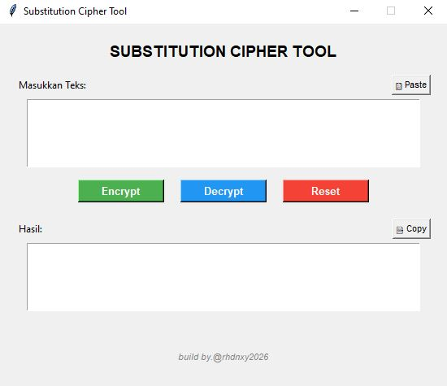

# Substitution Cipher Tool 🔐

A desktop-based graphical application built with Python and Tkinter that implements a custom substitution cipher. Unlike traditional substitution ciphers that only shuffle standard alphabets, this tool maps standard English characters, numbers, and symbols to a unique blend of international character sets (Arabic, Russian, and Thai), secured via a pseudo-random seed.


---

## ✨ Features

- **Graphical User Interface (GUI):** Clean, lightweight, and user-friendly desktop interface built with `tkinter`.
- **Unique Character Mapping:** Encrypts text into a combination of Arabic, Russian, and Thai unicode blocks using a deterministic pseudo-random seed (`seed=42`).
- **Clipboard Integration:** Quick **Copy** and **Paste** buttons for seamless text processing.
- **Reset Functionality:** Instantly clear input and output text boxes with a single click.

---

## 📸 Preview



---

## 🚀 Installation & Usage

1. **Clone the repository:**
   ```bash
   git clone https://github.com/rhdnxy/substitution-cipher-tool.git
   cd substitution-cipher-tool
   ```

2. **Run the application:**
   ```bash
   python src/cipher.py
   ```

---

## 🤝 Contributing
Contributions, issues, and feature requests are welcome! Feel free to check the [issues page](https://github.com/rhdnxy/substitution-cipher-tool/issues).

---

[]
